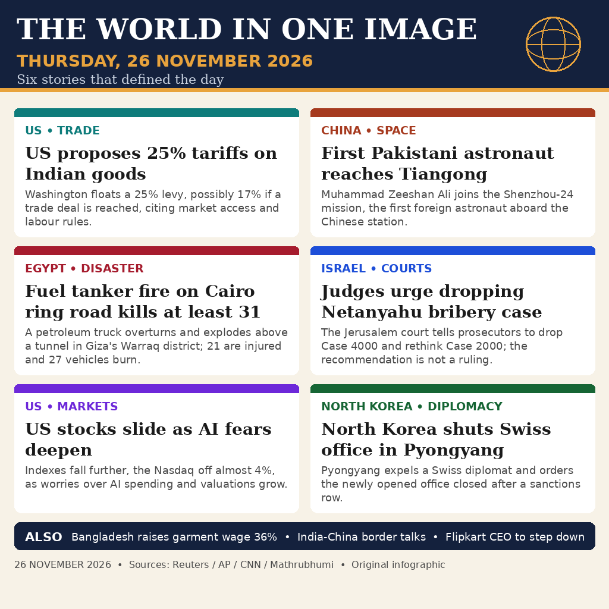

# The World in One Image — 26 November 2026

[](https://make.fun/bounty/news-image-20261126?utm_source=github&utm_medium=readme&utm_campaign=makefun)
[](https://make.fun/bounty/news-image-20261126?utm_source=github&utm_medium=readme&utm_campaign=makefun)
[](https://make.fun/bounty/news-image-20261126?utm_source=github&utm_medium=readme&utm_campaign=makefun)

Six stories that defined Thursday, 26 November 2026, in one 1024×1024 image.



## How it works

- `draw.py` renders the infographic from scratch with Pillow: a navy
  masthead with a gold wireframe globe, six story cards in a 2×3 grid
  (kicker, headline, summary each), an ALSO strip and a footer. It reads
  no clock, no network and no randomness, so it is deterministic.
- `main.py` is the entry point. It copies the finished `entry.png` into
  `$MAKEFUN_OUTPUT_DIR/entry.png` (creating the directory if needed).
  Run it the way the grader does:

  ```sh
  mkdir -p out && MAKEFUN_OUTPUT_DIR=out python3 main.py
  ```

## The six stories

1. US proposes 25% tariffs on Indian goods
2. First Pakistani astronaut reaches Tiangong
3. Fuel tanker fire on Cairo ring road kills at least 31
4. Judges urge dropping Netanyahu bribery case
5. US stocks slide as AI fears deepen
6. North Korea shuts Swiss office in Pyongyang

Sources: Reuters / AP / CNN / Mathrubhumi. All six stories are from the
news cycle of Thursday, 26 November 2026.

## Verify

Re-render the image and compare hashes — the two runs must match:

```sh
python3 draw.py /tmp/check-a.png
python3 draw.py /tmp/check-b.png
sha256sum /tmp/check-a.png /tmp/check-b.png entry.png
```

All three hashes are
`f2836d5f5b8f2bb5b86b9824325604914ab6c251b195d7ef54a46fe22bdf556f`.

## License

MIT — see [LICENSE](LICENSE).

---

Made with make.fun — [try it](https://make.fun/r/1xkk96y5)
